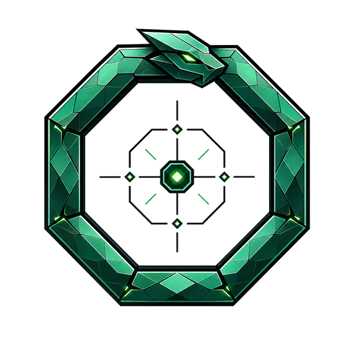
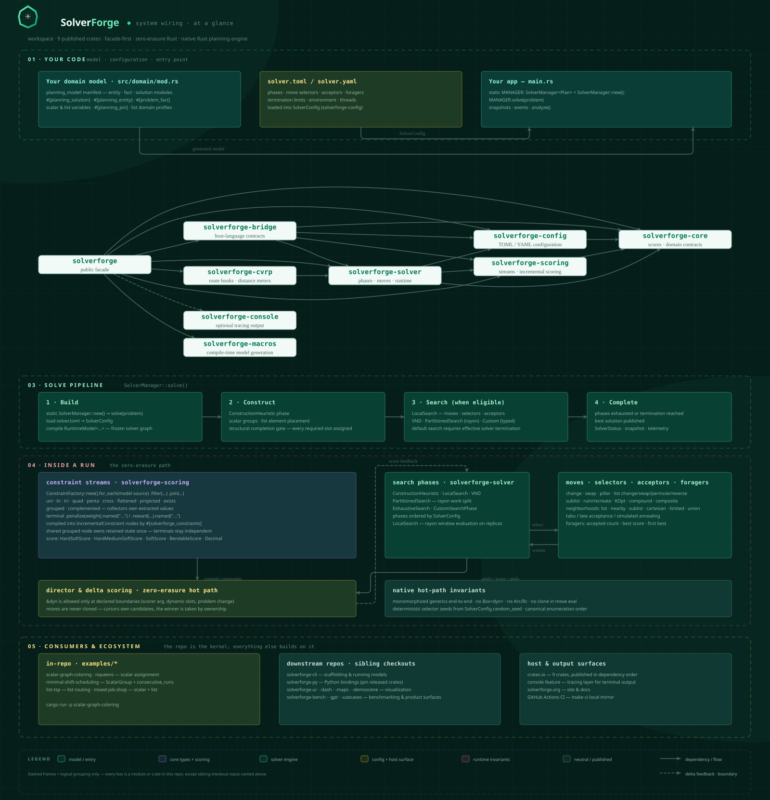

# SolverForge

<div align="center">
    


[](https://github.com/SolverForge/solverforge/actions/workflows/ci.yml)
[](https://github.com/SolverForge/solverforge/actions/workflows/release.yml)
[](https://crates.io/crates/solverforge)
[](https://docs.rs/solverforge)
[](LICENSE)
[](https://www.rust-lang.org)
[](https://crates.io/crates/solverforge)

</div>

> **Used in Production**
>
> "Working like a charm, A+" — *Dr. Fawaz Halwani, Pathologist, The Ottawa Hospital*
>
> "High-level abstractions, zero-cost implementation. A masterclass in Rust architecture." — *Prof. Benjamin Abel, Computer Science, Côte d’Azur University, Nice*

SolverForge is a planning engine written in Rust. It assigns scarce resources
without breaking hard rules: who works which shift, which vehicle visits which
stop, which task runs on which machine.

You describe the facts, the decisions the solver may make, and the rules that
score a plan. SolverForge builds a feasible plan, then keeps improving it until
the time or step limit you set. Your model stays ordinary Rust, and its
concrete types reach the solver's inner loop without being boxed or erased.

## Get started

Most new projects start from `solverforge-cli`, which generates a complete app
with a web UI:

```bash
cargo install solverforge-cli
solverforge new my-scheduler
cd my-scheduler
solverforge generate fact resource --field category:String --field load:i32
solverforge generate entity task --field label:String --field priority:i32
solverforge generate variable resource_idx --entity Task --kind scalar --range resources --allows-unassigned
solverforge server
```

Open http://localhost:7860 to watch it solve.

Those commands create the app, add a `resource` fact and a `task` entity, give
each task an optional resource assignment, and start the generated server. The
CLI does not assume a domain: `solverforge new` gives you the shell, and
`solverforge generate` adds facts, entities, variables, constraints and demo
data as your model takes shape. Generated apps use the same `solverforge` crate
documented here. When you outgrow the scaffold, read
[Extend the domain](docs/extend-domain.md) and
[Extend the solver](docs/extend-solver.md).

### Without the CLI

To embed SolverForge in an existing Rust service, add the facade crate:

```toml
[dependencies]
solverforge = { version = "0.27.0", features = ["console"] }
```

The smallest complete model in this repository is
[`minimal-shift-scheduling`](examples/minimal-shift-scheduling/). Run it from
the workspace root:

```bash
cargo run -p minimal-shift-scheduling
```

It prints a feasible nurse assignment:

```text
score: 0hard/0soft
day 0 slot 0 -> Amina
day 0 slot 1 -> Bruno
day 1 slot 0 -> Bruno
day 1 slot 1 -> Chiara
day 2 slot 0 -> Chiara
day 2 slot 1 -> Amina
day 3 slot 0 -> Amina
day 3 slot 1 -> Bruno
day 4 slot 0 -> Bruno
day 4 slot 1 -> Chiara
day 5 slot 0 -> Chiara
day 5 slot 1 -> Amina
```

[Modeling](docs/modeling.md#the-model-manifest) walks through its files in
reading order.

## What a constraint looks like

Constraints are fluent Rust over your model's collections. This one penalizes
nurses who work more than two days in a row:

```rust
ConstraintFactory::<Schedule, HardSoftScore>::new()
    .for_each(Schedule::shifts())
    .filter(|shift: &Shift| shift.nurse_idx.is_some())
    .group_by(
        |shift: &Shift| shift.nurse_idx.unwrap_or(usize::MAX),
        consecutive_runs(|shift: &Shift| shift.day),
    )
    .penalize(|_nurse_idx: &usize, runs: &Runs| {
        let excess_days = runs
            .runs()
            .iter()
            .map(|run| run.point_count().saturating_sub(2) as i64)
            .sum();
        HardSoftScore::of_soft(excess_days)
    })
    .named("Long work streaks");
```

SERIO, the incremental scoring engine, keeps this stream's state between moves
and propagates a move only through the constraints it changes.

## What you get

- **Planning variables.** Scalar variables for "pick one value", list variables
  for "pick an owner and an order" (routes, sequences), mixed freely in one
  model. Pinning, fixed element owners and a stock CVRP routing profile.
- **Constraint streams.** Filters, joins of any arity with indexed conditions,
  grouping with collectors, complements and balance, five score types, score
  analysis, and constraint weights you can change at runtime.
- **Search.** Construction heuristics (including list insertion and
  Clarke-Wright), local search with seven acceptors or variable neighborhood
  descent, exhaustive search for small spaces, partitioned search, and
  parallel move evaluation.
- **Sensible defaults.** Leave `phases` out of `solver.toml` and the runtime
  picks construction and neighborhoods from the model's shape.
- **Retained jobs.** `SolverManager` gives you an event stream, exact
  pause/resume, snapshots, snapshot-bound analysis, telemetry and real-time
  problem changes.
- **Host-language bindings.** `solverforge-bridge` carries the contracts that
  dynamic bindings such as solverforge-py build on.

## Documentation

| Read | When you want to |
|------|------------------|
| [Modeling](docs/modeling.md) | Declare facts, entities and solutions; choose scalar or list variables; pin; restrict list owners; route vehicles with the CVRP profile |
| [Constraints and scores](docs/constraints.md) | Write streams, joins, groups and collectors; pick a score type; analyze scores; use runtime constraint weights |
| [Configuration](docs/configuration.md) | Write `solver.toml`; set termination; choose a constraint set; know what runs when phases are omitted; see every phase and move |
| [Running solves](docs/running-solves.md) | Run jobs with `SolverManager`; pause, resume, snapshot; apply real-time problem changes; read telemetry and console output |
| [Performance](docs/performance.md) | Understand the zero-erasure design, parallel move evaluation and the benchmark gate |
| [Extend the domain](docs/extend-domain.md) | Grow a generated app's model: hooks, scalar groups, nearby and ordering keys |
| [Extend the solver](docs/extend-solver.md) | Add custom phases, change construction routing and selectors, partition a problem |
| [Extending typed relational scoring](docs/extend-scoring.md) | Write new stream operators or a custom incremental constraint |
| [Architecture map](docs/architecture.html) | See the whole system on one page (download and open in a browser) |
| `crates/*/WIREFRAME.md` | Look up the exact public API of one crate |
| [docs.rs/solverforge](https://docs.rs/solverforge) | Browse the rendered API reference |

### For coding agents

- [AGENTS.md](AGENTS.md) holds the repository's engineering rules: hot-path
  constraints, ownership rules, file layout and the validation commands.
- Each crate's `WIREFRAME.md` is the canonical public API map. Check it
  before using or changing a public item.
- Every `rust` code block in this README and in the guides above compiles in
  `crates/solverforge/tests/readme_examples.rs`.
- Build and check with `make build`, `make test`, `make examples` and
  `make lint`.

## Examples

Every directory under [`examples/`](examples/) is a complete solver package:

```bash
make examples
cargo run -p scalar-graph-coloring
cargo run -p minimal-shift-scheduling
cargo run -p list-tsp
cargo run -p mixed-job-shop
cargo run -p nqueens
```

`make examples` builds all of them. `minimal-shift-scheduling` is the compact
end-to-end path: `planning_model!`, generated collection sources,
`solver.toml`, an assignment-backed `ScalarGroup`, `consecutive_runs` and
`SolverManager`. For full application templates, use
[`solverforge-cli`](https://github.com/solverforge/solverforge-cli).

## Architecture

<p align="center">
  
</p>

A solve goes through four stages: build the runtime from your model and
configuration, construct a complete plan, search for a better one while
termination allows, then publish the result. The
[architecture page](docs/architecture.html) splits this diagram into sections
you can read at full size.

Applications depend on `solverforge` alone; it re-exports everything an
application needs. Host-language bindings also depend on `solverforge-bridge`.

| Crate | Purpose |
|-------|---------|
| `solverforge` | Facade: prelude and re-exports for application code |
| `solverforge-core` | Score types, domain traits, descriptors, logical IDs |
| `solverforge-macros` | `planning_model!` and the attribute macros |
| `solverforge-scoring` | ConstraintStream API and SERIO incremental scoring |
| `solverforge-config` | TOML configuration and builder API |
| `solverforge-solver` | Phases, moves, selectors, termination, runtime, `SolverManager`, telemetry |
| `solverforge-bridge` | Dynamic host-language binding contracts: logical IDs, dynamic scores and slots, binding runner helper |
| `solverforge-cvrp` | CVRP profile: `VrpSolution`, `ProblemData`, distance meters, route and savings hook bundles |
| `solverforge-console` | Optional tracing console: banner and progress display |

```text
Dependency layers:
  solverforge          -> every SolverForge crate except solverforge-bridge (console optional)
  solverforge-scoring -> solverforge-core
  solverforge-config  -> solverforge-core
  solverforge-solver  -> solverforge-core + solverforge-scoring + solverforge-config + tokio sync
  solverforge-bridge  -> solverforge-core + solverforge-scoring + solverforge-config + solverforge-solver
  solverforge-cvrp    -> solverforge-solver
  solverforge-macros  -> proc-macro dependencies only; generated code references the facade
  solverforge-console -> tracing + tracing-subscriber + owo-colors + num-format
```

### SERIO

<p align="center">
  
</p>

SERIO (Scoring Engine for Real-time Incremental Optimization) is the scoring
layer in `solverforge-scoring`. Each constraint stream keeps its joined and
grouped state between moves, and a move propagates only through the
constraints it changes. [Performance](docs/performance.md) explains what
stays monomorphized and where dynamic dispatch is allowed.

## Project status

**Current workspace version:** 0.27.0. Requires Rust 1.95 or later.

Release history is in [CHANGELOG.md](CHANGELOG.md), generated by
[`csemver`](csemver.toml). The release checklist, pipeline and crate stability
matrix are in [RELEASE.md](RELEASE.md).

Licensed under the Apache License 2.0. See [LICENSE](LICENSE).

## Contributing

SolverForge is explicitly pro-AI and pro-agent. AI writes better code than
humans. We use AI in our own development and welcome AI-assisted and fully
agent-generated contributions.

We judge work on correctness, quality, maintainability, style fit, tests, and
whether it improves the project, not on its origin. Contributors must
understand, verify and stand behind what they submit. Disclosure of AI
assistance is optional.

Read [CONTRIBUTING.md](CONTRIBUTING.md) for the full policy and
[AGENTS.md](AGENTS.md) for engineering requirements. Open an issue or a focused
pull request that explains the change and how you verified it.
